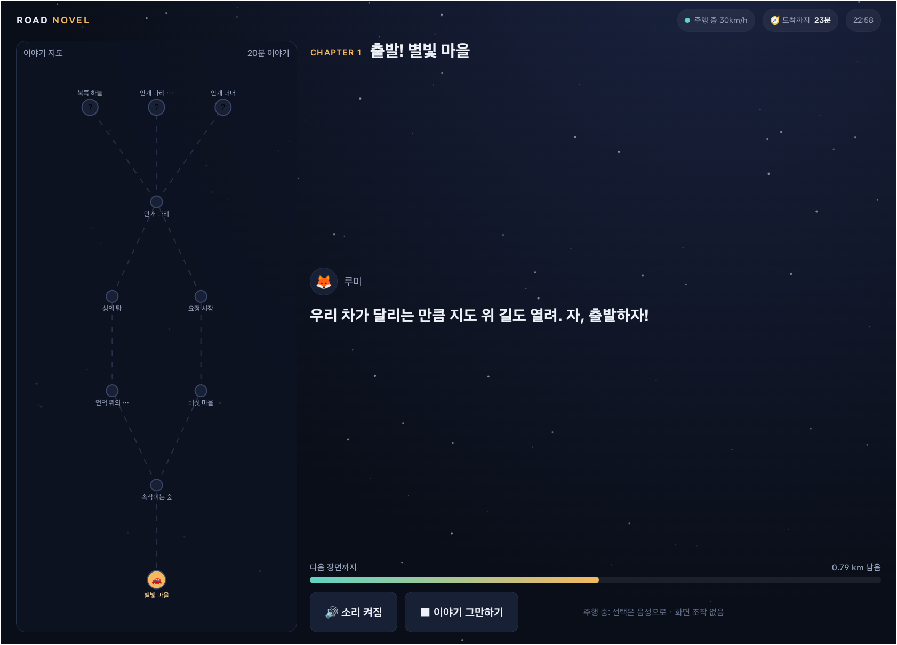

# ROAD NOVEL — 달리는 만큼 펼쳐지는 우리 가족 이야기

> 가족이 차 안에서 함께 듣는 오디오 이야기 앱 (현대자동차그룹 Pleos Connect용)

## 한눈에 보기

- 차가 달린 만큼 이야기 진행
- 갈림길에서 말로 고르면 결말 변화
- 다 듣지 못한 이야기는 다음 주행에서 이어 듣기

## 만든 이유

- 긴 이동 시간: 뒷자리 아이는 지루함, 운전자는 화면 조작 불가
- 영상·게임은 운전 중 위험, 일반 오디오북은 도착 시간과 길이가 맞지 않음
- 보지 않고 듣기만 하는 이야기로 해결 — 차의 움직임에 맞춰 길이와 흐름이 바뀜

## 동작 방식

1. 출발 전: 내비 도착 시간에 맞춰 이야기 길이(10 / 20 / 30분) 추천
2. 달리는 동안: 달린 거리만큼 다음 장면으로 진행, 신호 대기로 멈추면 짧은 쉬어 가는 이야기
3. 갈림길: 이야기가 질문 → "오래된 성!", "2번!"처럼 말로 대답 → 고른 길에 따라 결말 변화
4. 도착: 중간에 내려도 자동 저장, 다음 주행에서 그 장면부터 이어 듣기

## 화면

| ① 이야기 선택 | ② 재생 중 |
|---|---|
|  |  |
| 내비 도착 시간에 맞춘 이야기 길이 추천 | 달린 거리만큼 이야기 진행 |

| ③ 운전 중 화면 | ④ 음성 선택지 |
|---|---|
|  |  |
| 운전 중 화면 단순화, 조작 없이 듣기만 | 갈림길에서 말로 대답하면 결말 변화 |

| ⑤ 이어 듣기 |
|---|
|  |
| 다 듣지 못한 이야기는 다음 주행에서 이어 듣기 |

> 모든 화면: Pleos Connect 에뮬레이터(가상 차량)에서 실제 앱 실행 화면 (③은 시속 40km 주행 상태)

## 운전 안전

- 운전 중 화면 최소화: 차량 시스템의 주행 신호에 맞춰 선택 단계·설정·목록 자동 숨김, 버튼 하나로 시작
- 내비 안내 우선: 길 안내 음성이 나오면 이야기 일시정지, 안내가 끝나면 그 문장부터 다시 읽기
- 위험한 말 걸러내기: "창밖으로 손 내밀어 봐", "빨리 달려!" 같은 차 안 위험 행동·위험 운전 유도 표현 검사
- 줄거리 고정: 사건·갈림길·결말은 모두 미리 설계, AI는 짧은 추가 대사 자리에만 사용(검사 통과 시에만), 정차 중 "이 대사 신고하기" 가능
- 위치 저장 안 함: 멈춤 판단에 차량 속도만 사용, 저장하는 것은 달린 거리(km)뿐
- 게임 요소 없음: 점수·순위 없음, 들어 본 결말 목록은 정차 중에만 표시

## Pleos 기능 연결 결과

- Pleos Connect 에뮬레이터에서 직접 확인

| 하는 일 | 사용한 Pleos 기능 | 결과 |
|---|---|---|
| 달린 거리 읽기 | 차량(Vehicle) SDK — 주행거리 | 동작 확인 |
| 멈춤·출발 알기 | 차량 기어(P/D)·속도 신호 | 동작 확인 |
| 대사 읽어 주기 | 음성 합성(TextToSpeech) SDK | 동작 확인 |
| 말로 고르기 | 음성 인식(SpeechToText) SDK | 동작 확인 |
| 운전 중 화면 줄이기 | 주행 제한 신호 (차량 시스템) | 동작 확인 |
| 내비 안내 때 멈추기 | 오디오 우선순위 (Audio Focus) | 동작 확인 |

- Pleos 기능을 쓸 수 없는 환경에서도 가상 차량과 자막으로 처음부터 끝까지 시연 가능

## 제출 정보

- 팀명: **MOBINOVA**
- 앱 이름: **ROAD NOVEL** — 차가 달린 만큼 이야기가 이어지고, 탑승자가 말로 고른 선택에 따라 결말이 달라지는 차량용 오디오 이야기 앱
- APK: [`apk/MOBINOVA_RoadNovel_release.apk`](apk/MOBINOVA_RoadNovel_release.apk) (release 빌드, 서명됨)

## 테스트 환경

| 항목 | 내용 |
|---|---|
| 에뮬레이터 | Pleos Connect Emulator **v2.1.0** (Android 14, API 34) |
| 화면 규격 | **2560 × 1440** (가로), 160dpi |
| 개발 도구 | Android Studio, JDK 17 |
| 사용한 Pleos SDK | Vehicle 2.0.3, TextToSpeech 3.3.1, SpeechToText 3.3.1, LLM 2.1.3.2 |

필요한 설정
- 별도 계정·키 없이 동작 (음성은 온디바이스 모드)
- 말로 고르기: 에뮬레이터 실행 후 Extended Controls → Microphone에서 **호스트 마이크 입력 켜기** (켤 때마다 필요). 켜지 않으면 화면 버튼으로 고르거나 기본 선택으로 진행
- 차량 움직이기: Pleos Virtual Console에서 **기어를 D로 바꾸면 이야기가 진행**되고, P(주차)면 멈춤 (`adb forward tcp:8088 tcp:8088` → http://127.0.0.1:8088/)
  - 주행거리를 늘리면 그 거리만큼 더 정확하게 진행
- 처음 실행 시 속도 정보 권한(화면에는 "위치 정보"로 표시)을 허용하면 속도로 더 정확하게 진행

## 실행 방법

- APK로 설치: `adb install apk/MOBINOVA_RoadNovel_release.apk` → 앱 목록에서 ROAD NOVEL 실행
- 소스로 실행:
  1. Android Studio와 Pleos Connect 에뮬레이터 준비
  2. 이 저장소를 Android Studio에서 열고, 기기로 에뮬레이터 선택 후 ▶(Run)
  3. 앱에서 "이야기 고르기" → "출발"

- 실주행 시연 (약 2분 20초): 에뮬레이터에 디버그 빌드를 설치한 상태에서 `bash tools/drive_demo.sh` 실행
  - 가상 차량이 자동으로 달리고 멈추며 출발 → 정차 이야기 → 선택 → 내비 안내 → 결말까지 진행, 디버그 패널은 화면에 나오지 않음
  - 필요한 것: `adb`, `curl`, `python`(Pillow 라이브러리)
- 간단 시연 (약 2분): 재생 화면 오른쪽 아래 디버그 패널의 "시연 시작" → 가상 속도로 출발부터 결말까지 자동 진행

---

<b>자세히 보기</b>

### 사용한 리소스

| 리소스 | 출처 | 라이선스 · 이용 조건 |
|---|---|---|
| 효과음·배경음 6개 (`app/src/main/res/raw`) | 이 프로젝트에서 코드로 직접 합성 — [`tools/make_sounds.py`](tools/make_sounds.py). 다시 실행하면 같은 파일 생성 | 외부 음원 없음 |
| 앱 아이콘 (별 모양) | 코드로 직접 그린 벡터 | 이 저장소의 일부 |
| 이야기 "별지도 탐험대" | AI(Claude)로 초안 작성 → 팀이 검토·수정 | 이 저장소의 일부 |
| 앱 실행 화면 (`docs/screenshots`) | 실제 앱을 Pleos Connect 에뮬레이터에서 실행한 화면 | 이 저장소의 일부 |
| 화면의 인물 아이콘 (이모지) | 기기의 시스템 글꼴로 표시 | 기기 제공 |
| 체험용 시제품 글꼴 (Gowun Batang, Noto Sans KR) | Google Fonts에서 웹으로 불러옴 — 저장소에 파일 없음 | SIL Open Font License 1.1 |
| Pleos Connect SDK | 빌드할 때 Pleos Playground 저장소에서 내려받음 — 저장소에 파일 없음 | Pleos Playground 이용 약관 |
| 그 밖의 라이브러리 (AndroidX, Jetpack Compose, Hilt, Room, kotlinx) | 빌드할 때 내려받음 | Apache License 2.0 |

