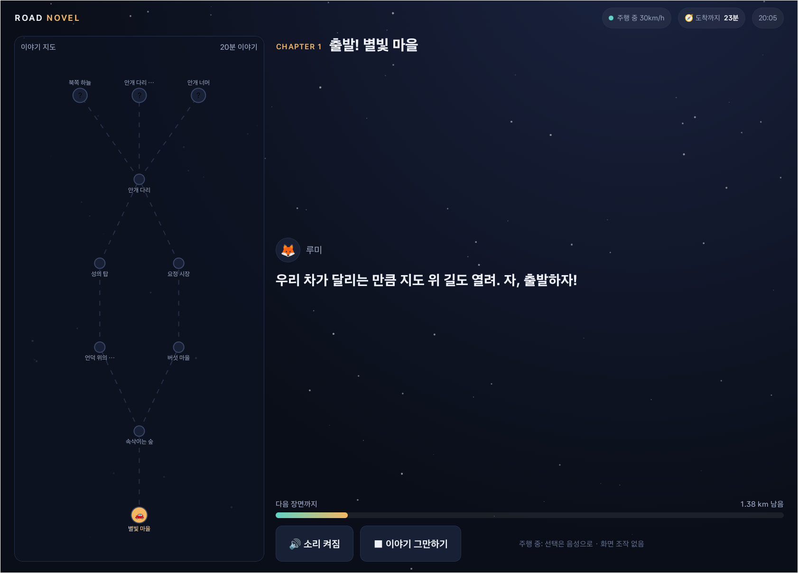
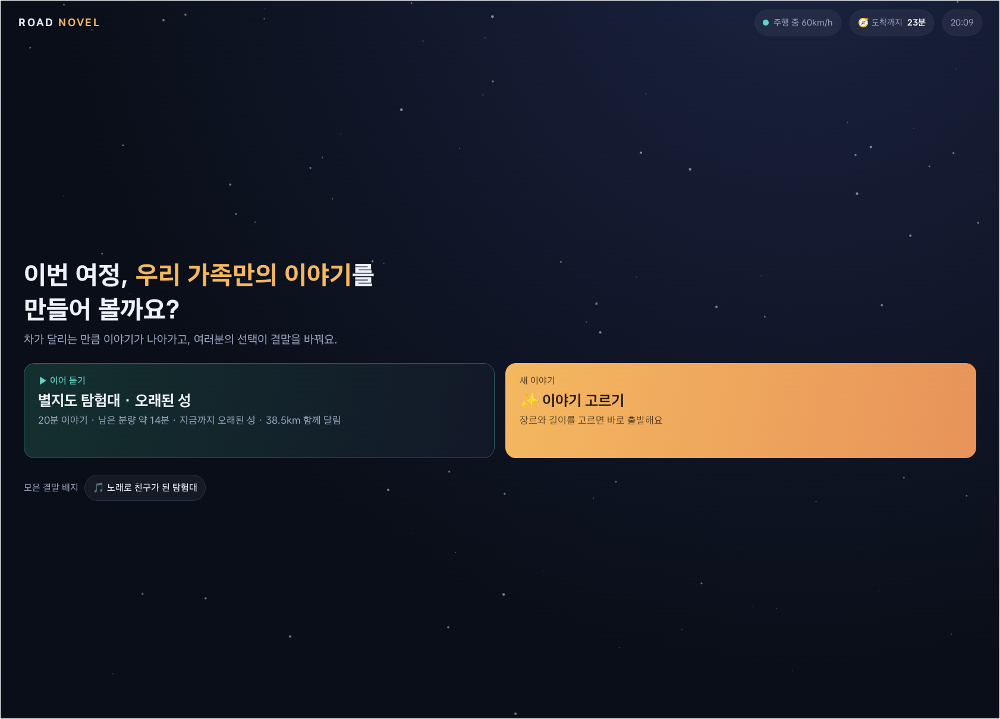

# ROAD NOVEL — 달리는 만큼 펼쳐지는 우리 가족 이야기

**차가 실제로 달린 거리와 멈춘 순간, 탑승자의 음성 선택에 따라 전개와 결말이 달라지는 차량용 인터랙티브 오디오 동화 앱**입니다.
현대자동차그룹 **Pleos Connect**(Android Automotive OS)용으로 만들었고, 원하는 길이(10/20/30분)만큼 듣다가 다음 주행에서 이어 들을 수 있어요.

| 재생 화면 | 음성 선택 | 이어 듣기 · 결말 배지 |
|---|---|---|
|  |  |  |

> 모든 화면은 Pleos Connect Emulator에서 실제로 실행해 캡처했어요. 더 많은 화면: [`docs/screenshots`](docs/screenshots)

---

## 핵심 기능

- 🚗 **달린 만큼 이야기가 나아가요** — 차량 주행거리(Odometer)를 기준으로 장면이 넘어가요. 막힌 길에서도 이야기가 멈추지 않도록 시간 기준 안전장치가 있어요.
- ⏱️ **길이 맞춤 (10 / 20 / 30분)** — 내비 도착 예정 시간을 보고 알맞은 길이를 추천해요. 짧은 이동이면 곁가지 장면을 건너뛰어요.
- 🏕️ **정차 이야기** — 신호 대기처럼 차가 멈추면 등장인물들이 잠깐 쉬어 가는 짧은 이야기가 나와요.
- 🎤 **음성으로 선택** — 갈림길에서 "오래된 성!", "2번!"처럼 말로 고르면 결말이 달라져요. 동승자는 화면의 큰 버튼으로도 고를 수 있어요.
- 🔊 **인물별 낭독** — Pleos TextToSpeech로 대사를 읽어 줘요. 운전 중에는 화면을 만질 필요가 없어요.
- 💾 **이어 듣기** — 장면이 바뀔 때마다 자동 저장되고, 앱이 갑자기 꺼져도 다음에 그 장면부터 이어 들을 수 있어요.
- 🏅 **결말 배지** — 받은 결말을 모아 "다른 선택"을 해 보고 싶게 만들어요.
- 🛡️ **어린이 안전** — 이야기의 뼈대(사건·분기·결말)는 미리 설계된 데이터로만 진행해요. AI 추가 대사 자리는 금칙어·길이·등장인물 검사(SafetyFilter)를 반드시 거쳐요.
- 🔒 **위치는 저장하지 않아요** — 정차를 알기 위해 차량 속도만 쓰고, 저장하는 건 달린 거리(km)뿐이에요.

## Pleos SDK 동작 확인 (Pleos Connect Emulator v2.1.0에서 직접 확인)

| 기능 | 사용한 SDK / API | 결과 |
|---|---|---|
| 이동 거리 | Pleos **Vehicle** SDK 2.0.3 — `Odometer` | ✅ 확인됨 (Virtual Console에서 주행거리를 올리면 장면이 넘어감) |
| 기어 (P/D) | AAOS `GEAR_SELECTION` (Pleos Gear API는 deprecated) | ✅ 확인됨 (P로 바꾸면 정차 이야기) |
| 차량 속도 | AAOS `PERF_VEHICLE_SPEED` | ✅ 확인됨 (지원·권한 확인, 신호 대기 판단용) |
| 낭독 | Pleos **TextToSpeech** 3.3.1 — ON_DEVICE | ✅ 확인됨 (대사마다 `onDone` 후 다음 대사) |
| 음성 선택 | Pleos **SpeechToText** 3.3.1 — ON_DEVICE | ✅ 확인됨 (녹음 파일로 "오래된 성", "2번" 인식 → 선택 반영) |
| AI 추가 대사 | Pleos **LLM** 2.1.3.2 | 🟡 구조만 준비 — 에뮬레이터에서 on-device LLM이 비활성 (`on-device LLM is disabled`). 지금은 미리 써 둔 대사로 동작하고, 이 대사에는 "✨ AI" 표시를 하지 않아요 |

SDK가 없거나 값이 안 나와도 **Mock(가짜 차량·자막)으로 끝까지 시연**할 수 있게 만들었어요.

## 실행 방법

1. **Android Studio**(최신)와 **Pleos Connect Emulator**(AVD)를 준비해요. AVD는 **Cold boot**로 켜야 차량 데이터가 나와요.
2. 이 저장소를 받아 Android Studio에서 **Open** → 폴더 선택 → Gradle 동기화가 끝날 때까지 기다려요.
3. 위쪽 실행 대상에서 **app**과 Pleos Connect Emulator를 고르고 ▶(Run)을 눌러요.
4. 처음 실행하면 마이크·차량 속도 권한을 물어요. (거부해도 버튼·기어로 동작해요)
5. **이야기 고르기 → 길이 선택 → 출발!**

### 바로 시연해 보기 (녹화용)
재생 화면 오른쪽 아래 **디버그 패널**을 펼치고 **🎬 시연 시작**을 누르면, 10분 이야기를 **약 2분**(에뮬레이터에서 1분 51초) 동안 자동으로 보여 줘요.
`출발 → 장면 진행 → 정차 이야기 → 선택 → 그만하기·저장 → 이어 듣기 → 결말`
(패널은 시연이 시작되면 숨겨져요. 다시 보려면 왼쪽 위 **ROAD NOVEL 로고를 길게** 누르세요.)

### 실제 차량 데이터로 시험하기
1. 디버그 패널에서 **Pleos 차량**을 골라요.
2. PC에서 `adb forward tcp:8088 tcp:8088` 후 브라우저로 http://127.0.0.1:8088/ (Pleos Virtual Console)을 열어요.
3. 기어를 **D**로 바꾸고 **Odometer**를 1km씩 올리면 이야기가 진행되고, **P**로 바꾸면 정차 이야기가 나와요.

### 빌드·테스트 (명령줄)
```bash
./gradlew assembleDebug        # APK 만들기 → app/build/outputs/apk/debug/
./gradlew testDebugUnitTest    # 단위 테스트 (스토리 엔진·안전 필터·차량 규칙 등)
```

## 폴더 구조

```
app/src/main/
  assets/stories/        이야기 데이터 (JSON) — 장면·분기·결말·정차 이야기
  java/com/roadnovel/
    story/               스토리 엔진 (순수 Kotlin, 단위 테스트)
    data/vehicle/        차량 데이터 (Pleos Vehicle·AAOS / Mock)
    data/navi/           내비 남은 시간 (Mock)
    data/save/           진행 저장·결말 배지 (Room)
    voice/               낭독·음성 인식 (Pleos TTS/STT / Android 기본 / 자막만)
    ai/                  AI 추가 대사 (Pleos LLM 구조 / 미리 쓴 대사) + SafetyFilter
    audio/               효과음·배경음
    ui/                  화면 (홈·이야기 선택·재생·결말·디버그 패널)
    di/                  Hilt 설정 (음성·AI·차량 엔진 고르기)
app/src/test/            단위 테스트
docs/screenshots/        에뮬레이터 실행 화면
tools/make_sounds.py     효과음·배경음 합성 스크립트
prototype/               브라우저용 체험 시제품 (HTML)
CLAUDE.md                설계·규칙 문서
```

## 사용한 리소스

| 리소스 | 출처 | 라이선스 · 이용 조건 |
|---|---|---|
| 효과음·배경음 6개 (`app/src/main/res/raw/*.wav`) | **이 프로젝트에서 코드로 직접 합성** — [`tools/make_sounds.py`](tools/make_sounds.py) (파이썬 표준 라이브러리만 사용). 스크립트를 다시 실행하면 저장소의 파일과 바이트 단위로 똑같은 파일이 나와요 | 외부 음원 없음 → 저작권 문제 없음 (이 저장소의 일부) |
| 앱 아이콘 (별 모양) | 코드로 직접 그린 벡터 (`res/drawable/ic_launcher_foreground.xml`) | 이 저장소의 일부 |
| 이야기 "별지도 탐험대" (`app/src/main/assets/stories`) | AI(Claude)로 초안 작성 → 팀이 검토·수정 | 이 저장소의 일부 |
| 화면 시안 (`docs/화면시안`) | AI(Claude)로 만든 HTML 시제품(`prototype/index.html`)의 화면 캡처 | 이 저장소의 일부 |
| 앱 실행 화면 (`docs/screenshots`) | 실제 앱을 Pleos Connect Emulator에서 실행한 화면 | 이 저장소의 일부 |
| 화면의 이모지 (🦊🐢🎵 등) | 기기(Android)의 시스템 글꼴로 표시 — 앱에 이미지·글꼴 파일을 넣지 않음 | 기기 제공 |
| 체험용 시제품 글꼴 (`prototype/index.html`의 Gowun Batang, Noto Sans KR) | Google Fonts에서 웹으로 불러옴 — 저장소에 파일 없음 | SIL Open Font License 1.1 (상업 이용·재배포 가능) |
| Pleos Connect SDK (Vehicle, TextToSpeech, SpeechToText, LLM) | Pleos Playground Maven 저장소에서 빌드할 때 내려받음 — 저장소에 SDK 파일 없음 | Pleos Playground 이용 약관을 따름 |
| 그 밖의 라이브러리 (AndroidX, Jetpack Compose, Hilt, Room, kotlinx) | Google Maven · Maven Central에서 빌드할 때 내려받음 | Apache License 2.0 |

소리를 다시 만들려면: `python tools/make_sounds.py` → `app/src/main/res/raw/`

## 기술 스택
Kotlin · Jetpack Compose · Coroutines/Flow · Hilt · Room · kotlinx.serialization · Pleos Connect SDK (Vehicle, TextToSpeech, SpeechToText, LLM)
