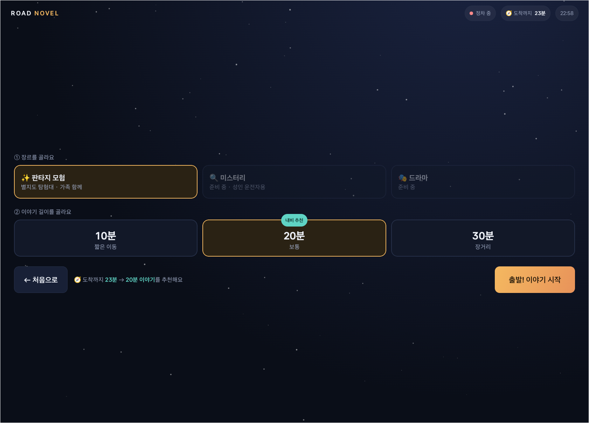
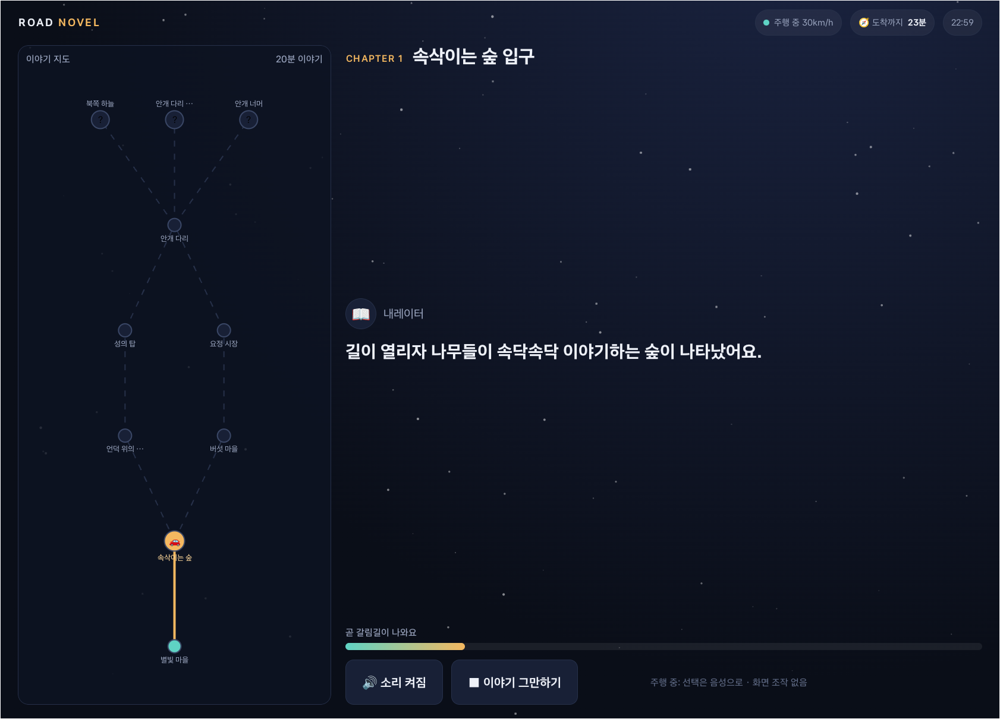
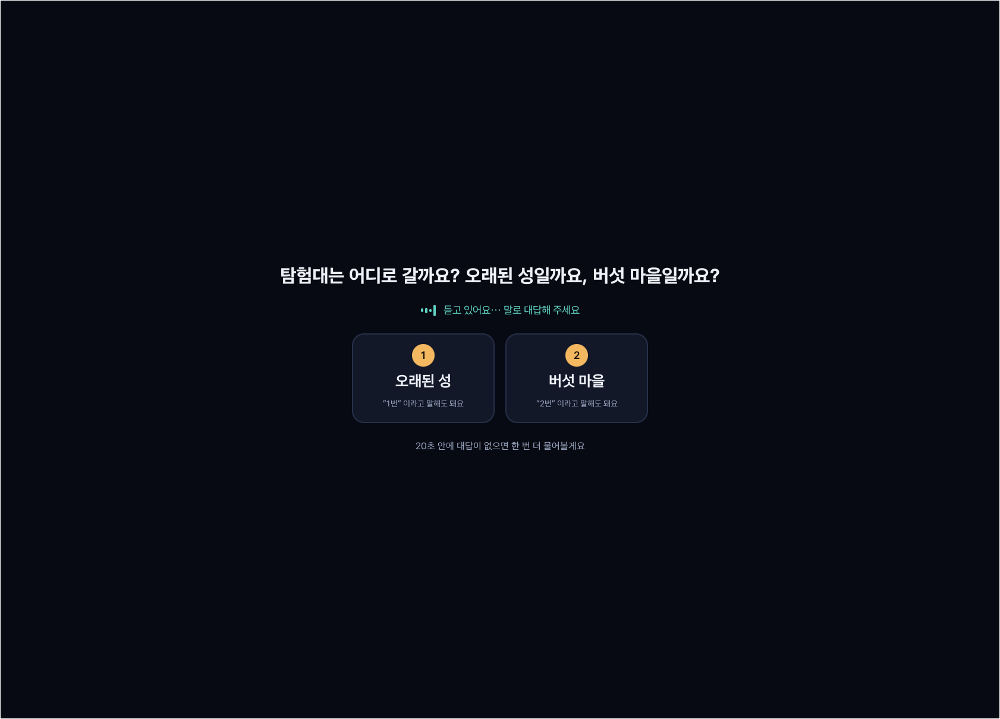

# ROAD NOVEL — 달리는 만큼 펼쳐지는 우리 가족 이야기

> 차 안에서 가족이 함께 듣는 **오디오 이야기 앱** · 현대자동차그룹 **Pleos Connect**용

## 한눈에 보기

- 차가 **달린 만큼** 이야기가 앞으로 나아가요.
- 갈림길에서 아이가 **말로 고르면** 결말이 달라져요.
- 다 못 들었으면 **다음 주행에서 이어서** 들어요.

## 왜 만들었나요

- 긴 이동 시간, 뒷자리의 아이는 지루해하고 운전자는 화면을 만질 수 없어요.
- 영상·게임은 운전 중에 위험하고, 일반 오디오북은 **도착 시간과 이야기 길이가 맞지 않아요.**
- ROAD NOVEL은 **차의 움직임에 맞춰 이야기의 길이와 흐름이 바뀌는**, 보지 않고 듣기만 하면 되는 이야기예요.

## 이렇게 동작해요

1. **출발 전** — 내비의 도착 시간을 보고 알맞은 이야기 길이(10 / 20 / 30분)를 추천해요.
2. **달리는 동안** — 실제로 달린 거리만큼 다음 장면으로 넘어가요. 신호 대기로 멈추면 등장인물들이 잠깐 쉬어 가는 짧은 이야기가 나와요.
3. **갈림길에서** — 이야기가 질문을 하면 "오래된 성!", "2번!"처럼 말로 대답해요. 고른 길에 따라 결말이 달라져요.
4. **도착하면** — 중간에 내려도 자동으로 저장돼서, 다음 주행에서 그 장면부터 이어 들어요.

## 화면

| ① 이야기 선택 | ② 재생 중 |
|---|---|
|  |  |
| 내비 도착 시간에 맞춰 이야기 길이를 추천해요 | 차가 달린 만큼 이야기가 나아가요 |

| ③ 운전 중 화면 | ④ 음성 선택지 |
|---|---|
|  |  |
| 운전 중에는 꼭 필요한 것만 보여 주고, 조작 없이 들으면 돼요 | 갈림길에서 말로 고르면 결말이 달라져요 |

| ⑤ 이어 듣기 |
|---|
|  |
| 오늘 못 다 들은 이야기는 다음 주행에서 이어서 들어요 |

> 모든 화면은 Pleos Connect 에뮬레이터(가상 차량)에서 실제 앱을 실행해 찍었어요. ③은 가상 차량을 시속 40km로 달리게 한 상태예요.

## 운전 안전을 먼저 생각했어요

- **운전 중에는 화면을 최소로** — 차가 달리기 시작하면 차량 시스템의 신호에 맞춰 선택 단계·설정·목록을 자동으로 숨기고, 버튼 하나로만 시작할 수 있게 줄여요.
- **내비 안내가 먼저** — 길 안내 음성이 나오면 이야기를 잠깐 멈추고, 안내가 끝나면 그 문장부터 다시 읽어요.
- **아이에게 위험한 말은 걸러요** — "창밖으로 손 내밀어 봐", "빨리 달려!" 같은 차 안 위험 행동·위험 운전을 부추기는 표현이 나오지 않게 검사해요.
- **줄거리는 미리 만든 대로만** — 사건·갈림길·결말은 미리 설계된 데이터로만 진행해요. AI는 짧은 추가 대사 자리에만 쓰고, 그것도 검사를 통과해야 들려줘요. 정차 중에는 "이 대사 신고하기"도 할 수 있어요.
- **위치는 저장하지 않아요** — 멈춤을 알기 위해 차량 속도만 쓰고, 저장하는 건 달린 거리(km)뿐이에요.
- **게임이 아니에요** — 점수·순위가 없고, 들어 본 결말 목록도 정차 중에만 보여요.

## Pleos 기능을 실제로 연결했어요

Pleos Connect 에뮬레이터에서 직접 확인한 결과예요.

| 하는 일 | 사용한 Pleos 기능 | 결과 |
|---|---|---|
| 달린 거리 읽기 | 차량(Vehicle) SDK — 주행거리 | 동작 확인 |
| 멈춤·출발 알기 | 차량 기어(P/D)·속도 신호 | 동작 확인 |
| 대사 읽어 주기 | 음성 합성(TextToSpeech) SDK | 동작 확인 |
| 말로 고르기 | 음성 인식(SpeechToText) SDK | 동작 확인 |
| 운전 중 화면 줄이기 | 주행 제한 신호 (차량 시스템) | 동작 확인 |
| 내비 안내 때 멈추기 | 오디오 우선순위 (Audio Focus) | 동작 확인 |
| AI 추가 대사 | LLM SDK | 연결 구조만 준비 — 에뮬레이터에서 이 기능이 꺼져 있어, 지금은 미리 써 둔 대사를 써요 |

Pleos 기능을 쓸 수 없는 환경에서도 **가상 차량과 자막으로 처음부터 끝까지 시연**할 수 있어요.

## 직접 실행해 보기

1. **Android Studio**와 **Pleos Connect 에뮬레이터**를 준비해요.
2. 이 저장소를 Android Studio에서 열고, 기기로 에뮬레이터를 골라 ▶(Run)을 눌러요.
3. **이야기 고르기 → 출발!**

**2분 시연 모드**: 재생 화면 오른쪽 아래 디버그 패널에서 **시연 시작**을 누르면, 출발 → 장면 진행 → 정차 이야기 → 선택 → 저장 → 이어 듣기 → 결말까지 약 2분 동안 자동으로 보여 줘요.

---

<details>
<summary><b>개발·심사용 자세한 정보 (펼치기)</b></summary>

### 앱이 쓰는 권한 (Pleos App Market 협의용)

| 권한 | 종류 | 쓰는 곳 | 없으면 |
|---|---|---|---|
| `pleos.car.permission.CAR_DRIVE` | Pleos 차량 | 주행거리(Odometer) 읽기 — Vehicle SDK | 가상 차량으로 동작 |
| `ai.pleos.playground.service.vehicle.VEHICLE_BINDING` | Pleos 차량 (SDK가 자동 추가) | Vehicle SDK 서비스 연결 | 위와 같음 |
| `android.car.permission.CAR_SPEED` | AAOS 차량 · 실행 중 허용 (화면에는 "위치 정보"로 보임) | 차량 속도(`PERF_VEHICLE_SPEED`) — 신호 대기 같은 정차 판단 | 기어로만 정차 판단 |
| `android.car.permission.CAR_POWERTRAIN` | AAOS 차량 | 기어(`GEAR_SELECTION`) — P면 정차 | 속도로 판단 |
| `pleos.car.permission.TTS_SERVICE` | Pleos 음성 | 대사 낭독 — TextToSpeech SDK | 자막만 |
| `pleos.car.permission.STT_SERVICE` | Pleos 음성 | 음성으로 선택 — SpeechToText SDK | 화면 버튼으로 선택 |
| `android.permission.RECORD_AUDIO` | Android · 실행 중 허용 | 음성으로 선택 (마이크) | 화면 버튼으로 선택 |
| `pleos.car.permission.LLM_SERVICE` | Pleos AI | AI 추가 대사 — LLM SDK (지금은 구조만) | 미리 쓴 대사 |
| `android.permission.INTERNET` | Android (Pleos SDK가 자동 추가) | Pleos SDK 서버 모드 (지금은 기기 안에서만 동작) | 기기 안에서 동작 |

위치(GPS)는 쓰지 않아요.

### 확인한 SDK 버전·방식
- Vehicle SDK 2.0.3 (주행거리), 기어·속도는 AAOS `GEAR_SELECTION`·`PERF_VEHICLE_SPEED`
- TextToSpeech / SpeechToText 3.3.1 — ON_DEVICE 모드 (앱 등록 없이 동작)
- LLM 2.1.3.2 — 에뮬레이터 로그 `on-device LLM is disabled`, 미리 쓴 대사로 대체 (이 대사에는 AI 표시를 하지 않음)
- 주행 제한: AAOS `CarUxRestrictionsManager` / 내비 안내: Audio Focus

### 가상 차량으로 시험하기 (Pleos Virtual Console)
1. 디버그 패널에서 **Pleos 차량**을 골라요.
2. PC에서 `adb forward tcp:8088 tcp:8088` 후 브라우저로 http://127.0.0.1:8088/ 을 열어요.
3. 기어를 **D**로 바꾸고 주행거리(Odometer)를 1km씩 올리면 이야기가 진행되고, **P**로 바꾸면 정차 이야기가 나와요.

에뮬레이터는 **Cold boot**로 켜야 차량 데이터가 나와요. 디버그 패널·시연 모드는 디버그 빌드에만 있어요.

### 빌드·테스트
```bash
./gradlew assembleDebug        # APK → app/build/outputs/apk/debug/
./gradlew testDebugUnitTest    # 단위 테스트 (이야기 진행 규칙·안전 필터·차량 규칙 등)
```

### 폴더 구조
```
app/src/main/
  assets/stories/        이야기 데이터 (JSON) — 장면·갈림길·결말·정차 이야기
  java/com/roadnovel/
    story/               이야기 진행 엔진 (단위 테스트)
    data/vehicle/        차량 데이터 (Pleos Vehicle·AAOS / 가상 차량)
    data/navi/           내비 남은 시간
    data/save/           진행 저장·들어 본 결말·대사 신고 기록
    voice/               낭독·음성 인식
    ai/                  AI 추가 대사 + 안전 필터
    audio/               효과음·배경음·오디오 우선순위
    ui/                  화면
    di/                  설정 (음성·AI·차량 엔진 고르기)
app/src/test/            단위 테스트
docs/screenshots/        에뮬레이터 실행 화면
tools/make_sounds.py     효과음·배경음 만드는 스크립트
prototype/               브라우저용 체험 시제품 (HTML)
```

### 사용한 리소스

| 리소스 | 출처 | 라이선스 · 이용 조건 |
|---|---|---|
| 효과음·배경음 6개 (`app/src/main/res/raw`) | 이 프로젝트에서 코드로 직접 합성 — [`tools/make_sounds.py`](tools/make_sounds.py). 다시 실행하면 똑같은 파일이 나와요 | 외부 음원 없음 |
| 앱 아이콘 (별 모양) | 코드로 직접 그린 벡터 | 이 저장소의 일부 |
| 이야기 "별지도 탐험대" | AI(Claude)로 초안 작성 → 팀이 검토·수정 | 이 저장소의 일부 |
| 앱 실행 화면 (`docs/screenshots`) | 실제 앱을 Pleos Connect 에뮬레이터에서 실행한 화면 | 이 저장소의 일부 |
| 화면의 인물 아이콘 (이모지) | 기기의 시스템 글꼴로 표시 | 기기 제공 |
| 체험용 시제품 글꼴 (Gowun Batang, Noto Sans KR) | Google Fonts에서 웹으로 불러옴 — 저장소에 파일 없음 | SIL Open Font License 1.1 |
| Pleos Connect SDK | 빌드할 때 Pleos Playground 저장소에서 내려받음 — 저장소에 파일 없음 | Pleos Playground 이용 약관 |
| 그 밖의 라이브러리 (AndroidX, Jetpack Compose, Hilt, Room, kotlinx) | 빌드할 때 내려받음 | Apache License 2.0 |

### 기술 스택
Kotlin · Jetpack Compose · Coroutines/Flow · Hilt · Room · kotlinx.serialization · Pleos Connect SDK

</details>
